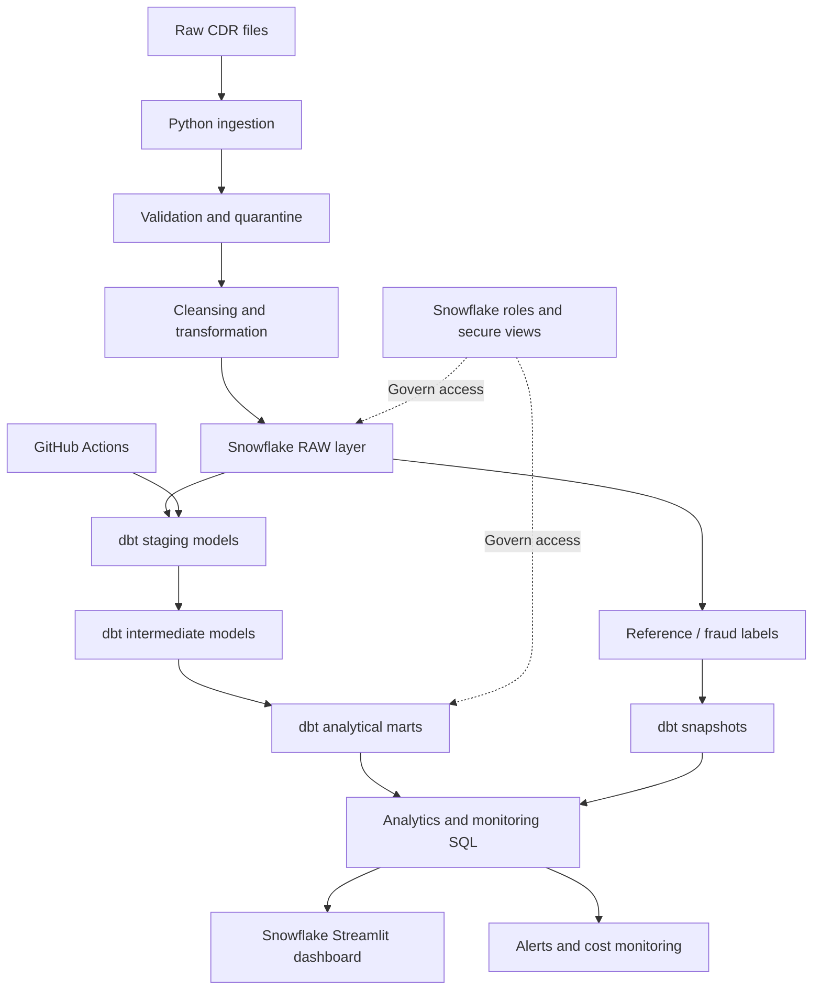

<div align="center">

# 📡 CDR Analytics Platform

### From raw telecom events to trusted, governed analytics.

**An end-to-end data engineering project built with Python, Snowflake, dbt and Streamlit.**

[](https://www.python.org/)
[](https://www.snowflake.com/)
[](https://www.getdbt.com/)
[](https://streamlit.io/)
[](https://github.com/features/actions)

<br/>

[**📊 Open Live Phase 9 Dashboard**](https://app.snowflake.com/fcpiyvj/ib86672/#/workspaces/ws/USER%24/PUBLIC/DEFAULT%24/CDR_ANALYTICS_PHASE9_DASHBOARD/streamlit_app.py)
&nbsp; · &nbsp;
[**📁 View GitHub Repository**](https://github.com/Beingkarthik/CDR-Analytics-Platform)

</div>

---

## 01 · What this project does

Telecommunication systems produce Call Detail Records (CDRs) containing information about calls, durations, timestamps, and charges. Raw records are not automatically ready for analysis: they can contain invalid values, inconsistent formats, duplicate or changing reference data, and operational issues that need to be detected.

The **CDR Analytics Platform** is a modular data engineering solution that demonstrates how telecom records can move through an analytics lifecycle:

- **Ingest** raw CDR files and prepare them for processing.
- **Validate** records and isolate invalid data for inspection.
- **Transform** raw datasets into consistent, analytics-ready structures.
- **Warehouse** curated data in Snowflake.
- **Model** data with dbt staging, intermediate, and mart layers.
- **Track history** with snapshot-based change capture for supported reference data.
- **Govern** access using Snowflake roles and secure views.
- **Observe** data quality, query activity, warehouse usage, and alerts.
- **Present** operational metrics in a Snowflake Streamlit dashboard.

> **Design principle:** preserve raw data, make transformations traceable, test the outputs, and state operational limitations honestly.

## 02 · Architecture at a glance



### Data flow

| Layer | Responsibility | Main technologies |
|---|---|---|
| Source | Raw CDR and reference data | CSV, Python |
| Ingestion | Extract, validate, log, and load | Python, Pandas |
| Quality | Clean records and quarantine rejected rows | Python, SQL |
| Warehouse | Store source and curated datasets | Snowflake |
| Transformation | Build reusable data models | dbt |
| History | Capture supported changes over time | dbt snapshots |
| Governance | Separate access and protect sensitive fields | Snowflake RBAC, secure views |
| Observability | Monitor data quality, queries, alerts, and credits | Snowflake SQL |
| Presentation | Display operational metrics | Snowflake Streamlit |
| CI | Validate dbt project configuration | GitHub Actions |

## 03 · Project roadmap

The repository is organized as a sequence of project phases. The phase names describe the intended lifecycle; implementation status varies by component.

| Phase | Workstream | Focus |
|---|---|---|
| 1 | Project kickoff | Scope, requirements, and planning |
| 2 | Data modeling | Source profiling, schema design, and DDL |
| 3 | Data ingestion | Extract, validate, load, watermark, and logging |
| 4 | Data transformation | Cleansing, standardization, and quarantine |
| 5 | Data warehouse | Fact/dimension loading, SCD processing, reconciliation |
| 6 | Orchestration | Airflow DAG and pipeline task coordination |
| 7 | Lineage and review | Data movement documentation and review |
| 8 | dbt and real-time ingestion workstream | Snowflake sources, dbt models, tests, and snapshots |
| 9 | Observability and performance | Dashboard, alerts, query benchmarks, and warehouse costs |
| 10 | Governance and deployment readiness | RBAC, secure-view validation, CI/CD preparation |

## 04 · Technology

| Area | Tools |
|---|---|
| Language | Python |
| Data manipulation | Pandas, PyArrow |
| Database / warehouse | Snowflake SQL |
| Transformation framework | dbt Core, dbt-snowflake |
| Dashboard | Snowflake Streamlit |
| Orchestration component | Apache Airflow |
| Testing | Pytest, dbt tests |
| Automation / CI | GitHub Actions |
| Version control | Git and GitHub |
| Data formats | CSV, Parquet |

## 05 · Repository map

```text
CDR-Analytics-Platform/
│
├── .github/
│   └── workflows/
│       └── dbt-ci.yml
│
├── data/
│   ├── raw/
│   ├── cleansed/
│   └── quarantine/
│
├── docs/
│   ├── architecture/
│   ├── er_diagram/
│   └── reports/
│
├── phase2_data_modeling/
│   ├── eda_profiling.sql
│   ├── schema_ddl.sql
│   └── schema_profiling.sql
│
├── phase3_data_ingestion/
│   └── pipeline/
│       ├── extract.py
│       ├── validate.py
│       ├── load.py
│       ├── watermark.py
│       ├── logger.py
│       └── main.py
│
├── phase4_transformation/
│   └── scripts/
│       ├── transform_cdr.py
│       ├── transform_fraud.py
│       ├── transform_plans.py
│       ├── quarantine.py
│       └── main.py
│
├── phase5_data_warehouse/
│   ├── ddl_scripts/
│   ├── etl_scripts/
│   └── validation/
│
├── phase6_airflow/
│   ├── dags/
│   └── scripts/
│
├── phase8_realtime_ingestion/
│   ├── dbt_project/
│   │   ├── models/
│   │   │   ├── staging/
│   │   │   ├── intermediate/
│   │   │   └── marts/
│   │   ├── snapshots/
│   │   ├── tests/
│   │   └── dbt_project.yml
│   ├── reference_python/
│   └── reference_sql/
│
├── phase9_observability_performance_cost/
│   ├── alerts/
│   ├── reports/
│   └── sql/
│
├── phase10_governance_security_deployment/
│   ├── sql/
│   ├── ci_cd/
│   └── docs/
│
├── requirements.txt
├── .env.example
└── README.md
```

*This is a navigation map of the main tracked components, not an exhaustive listing of every file.*

## 06 · Snowflake environment

The project’s documented Snowflake environment uses:

| Setting | Value |
|---|---|
| Database | `CDR_ANALYTICS` |
| Warehouse | `COMPUTE_WH` |
| Raw schema | `RAW` |
| Development schema | `DBT_DEV` |
| Production schema | `DBT_PROD` |
| Snapshot schema | `SNAPSHOTS` |
| Security demonstration schema | `SECURITY_DEMO` |

### Key data objects

- `CDR_ANALYTICS.RAW.CDR_RECORDS` — raw call detail records.
- `CDR_ANALYTICS.RAW.FRAUD_LABELS` — fraud-label reference data.
- `CDR_ANALYTICS.DBT_DEV.FACT_CDR_EVENTS` — development analytical fact model.
- `CDR_ANALYTICS.SNAPSHOTS.SNAP_DIM_FRAUD_LABELS` — snapshot history, where configured.

The development schema is used for the verified dbt development runs documented in this repository. The presence of a production schema or deployment workflow does **not** by itself mean that production deployment has been completed.

## 07 · Phase 9: Observability dashboard

<div align="center">

### 📊 CDR Analytics Platform — Operational Dashboard

[**Launch the Snowflake Streamlit Dashboard ↗**](https://app.snowflake.com/fcpiyvj/ib86672/#/workspaces/ws/USER%24/PUBLIC/DEFAULT%24/CDR_ANALYTICS_PHASE9_DASHBOARD/streamlit_app.py)

<sub>Snowflake account access and the required application permissions may be needed.</sub>

</div>

The Phase 9 dashboard brings important operational indicators into one place:

- Raw CDR record count.
- Curated gold fact record count.
- Invalid-record count.
- Failed-query monitoring for the inspected 24-hour window.
- Warehouse credit usage over the preceding seven days.
- Data-quality status and operational visualizations.

### Recorded validation snapshot

The following values are from the Phase 9 project report and represent the captured validation state, not permanent live totals.

| Indicator | Recorded value |
|---|---:|
| Raw CDR records | **10** |
| Gold fact records | **8** |
| Invalid raw records | **2** |
| Matching failed queries in inspected 24-hour window | **0** |
| Total duration in fact-table aggregate | **1,340 seconds** |
| Estimated charge in fact-table aggregate | **161 pence** |
| Average duration in fact-table aggregate | **167.5 seconds** |

The two invalid raw records had negative `DURATION_SECONDS` values and were excluded from the curated fact table. Warehouse credit usage is time-dependent and can change between dashboard refreshes.

## 08 · Data quality, alerting, and performance

### Data quality

The pipeline and monitoring work includes record validation, invalid-record identification, quarantine handling, curated fact checks, and dbt tests.

### Alerting status

| Component | Evidence-based status |
|---|---|
| Invalid CDR email alert | Tested; notification email received |
| Pipeline-failure alert | Started and evaluating; end-to-end failure-trigger email not demonstrated |
| Stale-data alert | Design documented; implementation pending verification |

### Performance and cost

Phase 9 includes baseline and modified aggregation query variants, query timing observations, and warehouse metering SQL. The recorded benchmark timings varied substantially on the small eight-row fact table. They should not be interpreted as proof of a stable optimization gain or a sustained 30% improvement.

Warehouse metering is based on Snowflake usage history. Credit values are time-dependent, and account-usage reporting can be delayed.

## 09 · Phase 10: Governance and security

The governance work documents a Snowflake role hierarchy and tests access behavior using a secure view.

Documented roles include:

- `CDR_ANALYST_ROLE`
- `CDR_DEV_ROLE`
- `CDR_PROD_ROLE`
- `CDR_SECURITY_ADMIN_ROLE`
- `CDR_DEPLOY_ROLE`

The supplied validation evidence demonstrates a secure view with `IS_SECURE = YES`, masked phone/email values for the analyst role, and unmasked synthetic demonstration values for the security-admin test.

GitHub Actions CI validation has been demonstrated. A protected production environment and deployment workflow have been prepared, but production deployment remains **pending** until the dedicated deployment identity and required RAW source-table permissions are verified. Automated deployment should use a dedicated least-privilege service identity, not a personal administrator account.

## 10 · Getting started locally

### Prerequisites

- Python 3.x
- Git
- Access to the repository
- Snowflake account and appropriate permissions for Snowflake/dbt tasks

### Clone the repository

```bash
git clone https://github.com/Beingkarthik/CDR-Analytics-Platform.git
cd CDR-Analytics-Platform
```

### Create and activate a virtual environment (Windows CMD)

```cmd
python -m venv .venv
.venv\Scripts\activate
```

### Install Python dependencies

```cmd
python -m pip install --upgrade pip
pip install -r requirements.txt
```

### Configure environment variables

Use `.env.example` as a reference and create a local `.env` file if required by the selected pipeline component. Populate it with your own authorized connection settings.

**Security:** Never commit `.env`, passwords, private keys, tokens, or other credentials. Do not put secrets directly into source code or README examples.

## 11 · Running the dbt development project

From the repository root, navigate to the dbt project:

```cmd
cd phase8_realtime_ingestion\dbt_project
```

Configure a local dbt profile using `profiles.example.yml` as a reference. Keep actual credentials outside Git.

Check the connection:

```cmd
dbt debug --target dev
```

Parse the project:

```cmd
dbt parse --no-partial-parse
```

Build development models and run associated tests:

```cmd
dbt build --target dev
```

These commands run in a local terminal with dbt installed and a valid Snowflake profile. They are not SQL statements to paste into a Snowflake worksheet.

## 12 · Testing

Python tests can be run from the repository root:

```cmd
pytest
```

dbt validation can be run from the dbt project directory:

```cmd
dbt test --target dev
```

For a full development build, use:

```cmd
dbt build --target dev
```

Run only after the local environment, dependencies, profile, and Snowflake permissions are configured.

## 13 · Security and contribution hygiene

- Keep raw, cleansed, and quarantined data logically separated.
- Use least-privilege Snowflake roles.
- Keep credentials in local environment configuration or approved secret stores.
- Do not commit `.env`, `.venv`, logs, private credentials, or sensitive customer data.
- Use synthetic or appropriately authorized data in demonstrations.
- Review SQL scripts before executing statements that modify or delete data.
- Validate changes in the development target before considering production deployment.

## 14 · Current implementation status

| Area | Current documented status |
|---|---|
| Python ingestion and transformation components | Present in repository |
| Snowflake/dbt development models | Present; development validation demonstrated |
| SCD snapshot validation | Demonstrated in project evidence |
| Phase 9 Streamlit dashboard | Deployed and viewed |
| Invalid-record email alert | Tested; email received |
| Pipeline-failure email trigger | Not demonstrated end to end |
| Stale-data alert | Design documented; implementation pending |
| Phase 10 role and secure-view checks | Demonstrated in supplied evidence |
| GitHub Actions CI | Successful run demonstrated |
| Production deployment | Pending final permission and service-identity verification |

## 15 · Future improvements

- Validate the pipeline with larger, representative CDR datasets.
- Expand automated data-quality and reconciliation coverage.
- Complete end-to-end pipeline-failure alert testing.
- Establish a verified ingestion timestamp and freshness threshold before deploying stale-data monitoring.
- Run controlled, repeatable performance benchmarks at realistic data volumes.
- Complete production deployment readiness checks using a dedicated service identity.
- Extend dashboard filters, drill-downs, and historical trend analysis.

## 16 · Team

This project was developed collaboratively by:

| Team member | Roll number |
|---|---|
| PADMA HAMSIKA | `2401100CSE0156` |
| NALLAPA REDDY DURGESH REDDY | `2401100CSE0212` |
| N YASH KRISHNA | `2401100CSE0210` |
| ANUSHKA YADAV | `2401100CSE0179` |
| BOJOGU RAGHAVENDRA | `2401100CSE0123` |
| KANCHANAPALLY ADVIKA | `2401100CSE0138` |
| NANAVATH KARTHIK | `2401100CSE0155` |
| SHAGA SAI CHARAN | `2401100CSE0225` |

---

<div align="center">

### Built to turn telecom data into dependable insights.

**Python · Snowflake · dbt · Streamlit · SQL · GitHub Actions**

[Repository](https://github.com/Beingkarthik/CDR-Analytics-Platform) · [Live Phase 9 Dashboard](https://app.snowflake.com/fcpiyvj/ib86672/#/workspaces/ws/USER%24/PUBLIC/DEFAULT%24/CDR_ANALYTICS_PHASE9_DASHBOARD/streamlit_app.py)

</div>
